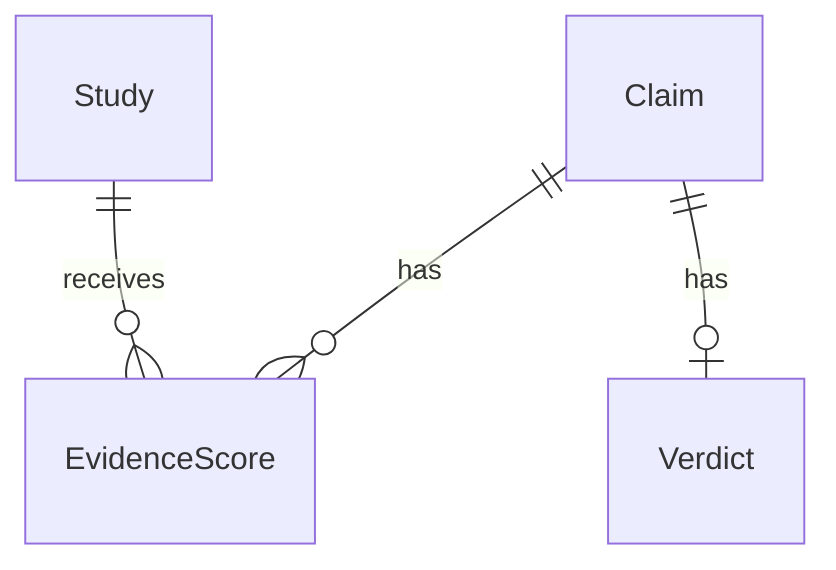

# SecondOpinion
Busting health myths backed by science.

## Project structure

- `frontend/` — React + TypeScript (Vite)
- `backend/` — Python API (FastAPI)

## Getting started

### Backend

```
cd backend
python -m venv .venv
source .venv/bin/activate  # or .venv\Scripts\activate on Windows
pip install -r requirements.txt
uvicorn app.main:app --reload
```

Runs on http://localhost:8000. Health check at `/api/health`.

### Frontend

```
cd frontend
npm install
npm run dev
```

Runs on http://localhost:5173 and proxies `/api` requests to the backend.

## Documentation

- [Evidence-grading framework notes](docs/evidence-grading.md)

### Editable backend templates (issue #3)

Start with these two files:

- `backend/app/evidence_models.py`: fields for `Claim`, `Study`, `EvidenceScore`, and `Verdict`. Optional fields explain why they can be unknown.
- `backend/app/evidence_workflow.py`: `create_claim`, `normalize_claim`, `score_study`, and `generate_verdict`.

`create_claim` works in memory. The other functions deliberately raise
`NotImplementedError` until their rules are implemented. Edit one function at a
time; these templates are not connected to API routes or a database.



A study can be reused across claims, but its score belongs to a specific claim.
The proposed schema keeps one current verdict per claim. `None` means unknown
or not assessed; it is different from a score of zero or a checked `False` flag.
IDs are generated in memory; foreign keys, uniqueness, and other database
constraints belong in the later migrations.

Before closing issue #3: agree on the fields and confidence format, post the
relationship diagram to the issue, and collect all four teammates' approvals.
Scoring rules, retrieval, API wiring, and migrations remain separate follow-up work.
