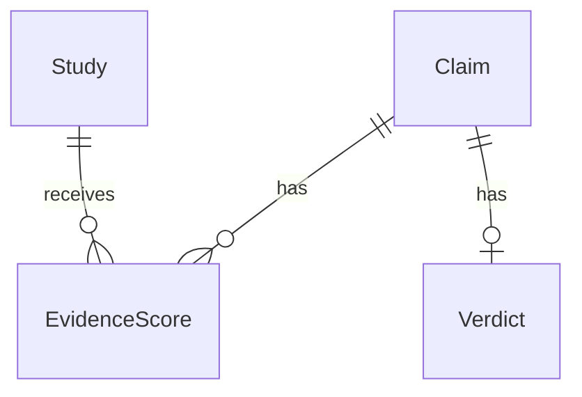

# SecondOpinion
Busting health myths backed by science.

## Project structure

- `frontend/` — React + TypeScript (Vite)
- `backend/` — Python API (FastAPI)

## Getting started

### Backend

Requires Python 3.11+.

```
cd backend
python -m venv .venv
source .venv/bin/activate  # or .venv\Scripts\activate on Windows
pip install -r requirements-dev.txt
uvicorn app.main:app --reload
```

Runs on http://localhost:8000. Health check at `/api/health`. API docs at `/docs`.

Credentials and optional settings go in `backend/.env` (see `backend/.env.example`).

To run the tests:

```
cd backend
source .venv/bin/activate  # or .venv\Scripts\activate on Windows
pytest
```

Backend layout:

```
backend/app/
  main.py       # app factory, middleware, router registration
  config.py     # settings loaded from env / .env
  routers/      # HTTP endpoints (thin, delegate to services)
  models/       # pydantic schemas
  services/     # source API clients, normalization, grading
backend/tests/  # pytest suite
```

Endpoints (full schemas at `/docs`):

| Method | Path | Description |
|---|---|---|
| GET | `/api/health` | Status and API version |
| GET | `/api/pubmed/search?q=...&limit=20` | Search PubMed, returns full study records in relevance order |
| GET | `/api/pubmed/articles/{pmid}` | One PubMed record by PMID, 404 if it does not exist |

PubMed calls are rate limited to stay under NCBI's ceiling (3 requests/second, or 10 with `NCBI_API_KEY` set) and retried on throttling or outages. If PubMed stays down the API returns 503. Tests run against recorded responses in `backend/tests/fixtures/`, so they never hit the live API.

### Frontend

```
cd frontend
npm install
npm run dev
```

Runs on http://localhost:5173 and proxies `/api` requests to the backend.

**Tech:** React 18 + TypeScript, Vite, plain CSS (no framework). Design tokens live in `src/styles/theme.css`. Fonts are Comfortaa (body/UI, weights 500–700) and Homemade Apple (the "doctor's handwriting": the "Second" in the logo, "Mythbusters" on About, and handwritten notes), loaded via Google Fonts in `index.html`.

**Design system:**
- **Light and dark mode.** A sun/moon capsule toggle in the nav bar switches themes. The choice is saved in `localStorage` (`useTheme.ts`); dark is the default.
- **Gradients.** Both themes use the Figma gradient's angle and stops (114deg, 0 / 19 / 43 / 69 / 88 / 100%). Light mode runs sky blue to cream; dark mode ("ink & cream") is near-black navy with the Figma blue (#125FC9) as soft corner glows. The gradient is pinned to the viewport.
- **Liquid glass.** `.glass-card`, `.glass-pill` and `.glass-panel` read semantic tokens (`--card-bg`, `--text-strong`, …) defined per theme in `theme.css`, so components never hard-code theme colours.
- **Dark top, light bottom.** In dark mode, the Search and About pages keep their lower half light (the result area and the team). Those sections set their own light tokens in their CSS, so they stay readable in dark mode no matter what.
- **Props.** The paper Rx pad, the lab-report clipboards, the foil blister strips and the ink stamps look the same in both themes.

**Pages:**

| Screen | Component | Notes |
|---|---|---|
| Search + result (home) | `SearchScreen.tsx`, `ResultScreen.tsx` | Capsule search bar, example claims, loading/error states, and live PubMed results below. Study records include abstracts, integrity flags, and on-demand assessments. |
| How it works | `HowItWorksPage.tsx`, `how/` | A capsule travels down a glass tube past three stations. Each station is a lab-report clipboard holding a working demo (normalize a messy claim, grade a study type, run a retraction scan); an ink stamp (NORMALIZED / GRADED / 1 RETRACTED) lands when you finish it. |
| About | `AboutPage.tsx` | Hero with a paper Rx pad, project capsule with the verdicts in a foil blister strip and a GitHub link, team as glass capsules with photos and roles, advisor capsule. Team info lives in `src/data/team.ts`; photos in `src/assets/team/` (`carson.jpg`, `nj.jpg`, …) are picked up automatically, with initials as a fallback. |

Navigation is React state in `App.tsx`, no router installed yet: the logo resets to search, nav links switch pages. `react-router-dom` is a quick follow-up if shareable links are needed.

**Backend integration status:** `POST /api/claims` accepts `{ "claim": "..." }`,
normalizes the claim through Foundry, and retrieves up to 20 PubMed articles.
It returns `claim`, `normalized`, `evidence` (query, total count, articles), and
`assessment_status: "pending"`, plus `assessments` keyed by PMID. The frontend
displays study records, abstracts, metadata-based categories, flags, and
provisional design weights. Relevance and findings can be assessed on demand for each abstract. No verdict or confidence is generated yet. Empty searches return 200
with an empty article list; invalid claims return 422, and provider failures
return 502/503. Foundry credentials stay in the backend environment.

Run both development servers using the commands above, then submit a claim in
the browser. The Vite development proxy forwards `/api` to port 8000. Production
hosting must also route `/api` to the backend; the Vite proxy is development-only.

Frontend layout:

```
frontend/src/
  assets/
    team/                team photos for the About page
  components/
    NavBar.tsx            logo, page links, theme toggle
    SearchScreen.tsx      search + result page (dark top, light bottom)
    ResultScreen.tsx      live studies, abstracts and on-demand assessments
    result/              reserved verdict presentation components (not connected)
      VerdictResult.tsx   verdict capsule, explanation, related claims
      ScoreTip.tsx        the "?" tooltip next to the confidence score
      ReferralTabs.tsx    further reading: tabbed referral sheets
    HowItWorksPage.tsx    capsule tube + stations
    how/
      Clipboard.tsx       lab-report clipboard with an ink stamp
      NormalizeDemo.tsx   interactive demo: claim normalization
      GradingDemo.tsx     interactive demo: evidence grading
      RetractionDemo.tsx  interactive demo: retraction checks
    AboutPage.tsx         project, team and advisor
  data/
    team.ts               names, roles and blurbs for the About page
  hooks/
    useClaimChecker.ts    shared state + fetch logic for checking a claim
    useTheme.ts           light/dark mode, remembered per browser
  styles/
    theme.css            design tokens, gradient, glass utility classes
  types.ts               shared TypeScript types
  App.tsx                page routing (state-based) + top-level layout
```

**Known gaps:** overall evidence synthesis and verdict generation, accessibility pass (#28), usability testing (#27).

## Documentation

- [Evidence-grading framework notes](docs/evidence-grading.md)

### Editable backend templates (issue #3)

Start with these two files:

- `backend/app/evidence_models.py`: fields for `Claim`, `Study`, `EvidenceScore`, and `Verdict`. Optional fields explain why they can be unknown.
- `backend/app/evidence_workflow.py`: `create_claim`, `normalize_claim`, `score_study`, and `generate_verdict`.

`create_claim` works in memory. `normalize_claim` returns a search query using
the retrieval-only normalization service described below. Scoring and verdict
functions deliberately raise `NotImplementedError`. Edit one function at a
time; these templates are not connected to API routes or a database.



A study can be reused across claims, but its score belongs to a specific claim.
The proposed schema keeps one current verdict per claim. `None` means unknown
or not assessed; it is different from a score of zero or a checked `False` flag.
IDs are generated in memory; foreign keys, uniqueness, and other database
constraints belong in the later migrations.

Before closing issue #3: agree on the fields and confidence format, post the
relationship diagram to the issue, and collect all four teammates' approvals.
Scoring rules, retrieval, API wiring, and migrations remain separate follow-up work.

### Claim normalization (issue #11)

`POST /api/claims/normalize` sends a claim to Azure Foundry and returns
`query`, `intervention`, `outcome`, `population`, `relation`, `negated`, and
`version`. It does not decide whether the claim is true.

Copy `backend/.env.example` to the gitignored `backend/.env` and configure:

```dotenv
AZURE_FOUNDRY_ENDPOINT=https://YOUR-RESOURCE.openai.azure.com/openai/v1
AZURE_FOUNDRY_DEPLOYMENT=YOUR-MODEL-DEPLOYMENT-NAME
AZURE_FOUNDRY_API_KEY=YOUR-RESOURCE-KEY
```

Use the **model deployment name**, not the Foundry project name. The deployment
must support Chat Completions structured outputs. Use the resource URL or its
`/openai/v1` base, not a project URL or `/responses` URL. Restart the backend
after changing settings; `.env` loads from `backend/` regardless of working directory.

```sh
curl http://localhost:8000/api/claims/normalize \
  -H 'Content-Type: application/json' \
  -d '{"raw_text":"does zinc cure colds lol"}'
```

This returns a query such as `(zinc) AND (common cold)`. Pass that query to
`GET /api/pubmed/search`; the `/api/claims` endpoint combines these steps for the frontend.

Code to read, in order:

- `app/routers/normalization.py`: validates requests and maps errors to HTTP status.
- `app/services/normalization.py`: asks Foundry for fields, validates them, builds the query.
- `app/models/normalization.py`: the returned data contract.

The workflow's `normalize_claim` wrapper uses the same service and returns only
the query string. Negation stays in the structured fields, so retrieval can find
evidence on either side. Invalid claims return 422; configuration/provider errors
return 503. Each service call logs raw input, normalized output, and errors at
INFO level; enable a structured formatter to persist those log attributes.

Tests mock Foundry and cover the request, output validation, negation, logging,
and HTTP errors. `tests/fixtures/normalization_seeds.csv` preserves 20 provisional
examples for future live evaluation; these are not proof of model accuracy.
The team's canonical seeds and their retrieval relevance still need validation.

### Preliminary study classification

`app/services/assessment.py` implements publication-type classification and
`base_weights_v0.1` from the evidence-grading notes. Specific study designs take
precedence over generic publication formats; conflicting designs stay unknown.
Research syntheses retain an unknown weight until included designs are resolved.
Retraction flags exclude findings; notice records are withheld. Preprints and
animal-only indexing are marked separately. Missing abstracts retain the design
weight while flagging limited information. All effective weights remain zero
until relevance and findings are assessed. No numeric aggregation is performed.

These rules use the retrieved PubMed fields only. Linked corrections/concerns are retained and flagged, but their impact is not
resolved. Crossref checks and abstract-based design resolution are not implemented yet.
Foundry finding extraction is available on demand as described below. No notice flag should be read as an integrity clearance.

### Abstract findings

Each study has an **Assess abstract** button. It calls
`POST /api/claims/articles/{pmid}/assess` with `{ "claim": "..." }`. The backend
retrieves the article by PMID and asks Foundry for relevance, a finding, a short
summary, and supporting abstract passages. Exact passages are validated against
the abstract with whitespace normalization; invalid output returns 503 and can
be retried. This checks quotation provenance, not whether the model's reasoning
is correct. Assessments are held in browser memory for the current results only.

Missing abstracts, retracted articles, and integrity-notice records skip Foundry.
Study weights remain metadata-based; effective weights stay zero while synthesis
eligibility is unresolved. No overall verdict is generated. Each assessment is
one additional Foundry call, initiated on demand to keep retrieval responsive.

Linked PubMed integrity records are retained in `integrity_links`, including
relation direction, notice PMID (when present), citation and note. `RetractionIn`
marks an affected paper; `RetractionOf` identifies a notice about another paper.
Linked corrections and expressions of concern withhold findings pending review;
the application does not yet retrieve notice text or determine its impact.

Abstract assessments also return `sample_sizes` and `effect_estimates`. Each
contains exact `reported` text and a containing source `passage`, validated
against the abstract. Empty lists mean no value was reported or identified,
not zero. Counts are not summed, effects are not converted, and confidence
intervals are retained when extracted. These values do not change design weights.
Quote matching verifies provenance, not the correctness of AI interpretation.

If the full normalized query returns no matches, claim retrieval retries once
with the intervention/exposure alone. `search_scope: "intervention_only"` marks
these broader results; the UI shows both queries and warns that outcome and
population relevance are unconfirmed. The full original claim is still used
for abstract assessment.

Assessment provider request failures return 503. Invalid or unsupported model
output returns 502, with a retry message. Server logs include PMID, processing
stage and HTTP status when available, but omit credentials, claims, abstracts
and provider response bodies.

Measurement extraction is best-effort: sample sizes or effect estimates that
fail exact-source checks are omitted individually and reported in
`measurement_warnings`. Valid findings and supporting passages remain available.
Unsupported main supporting passages still reject the assessment with 502.
