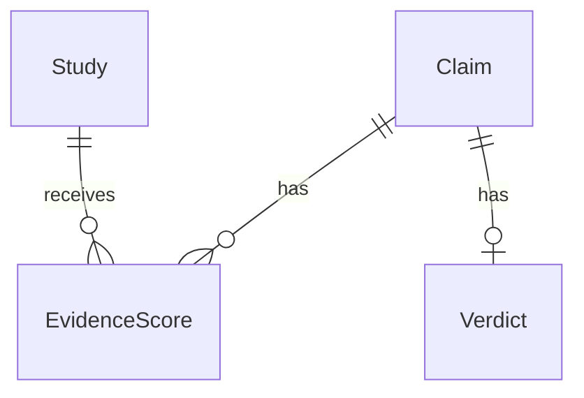

# SecondOpinion
Busting health myths backed by science.

## Project structure

- `frontend/` — React + TypeScript (Vite)
- `backend/` — Python API (FastAPI)

## Getting started

### Backend

Requires Python 3.11+.

```
cd backend
python -m venv .venv
source .venv/bin/activate  # or .venv\Scripts\activate on Windows
pip install -r requirements-dev.txt
uvicorn app.main:app --reload
```

Runs on http://localhost:8000. Health check at `/api/health`. API docs at `/docs`.

Credentials and optional settings go in `backend/.env` (see `backend/.env.example`).

To run the tests:

```
cd backend
source .venv/bin/activate  # or .venv\Scripts\activate on Windows
pytest
```

Backend layout:

```
backend/app/
  main.py       # app factory, middleware, router registration
  config.py     # settings loaded from env / .env
  routers/      # HTTP endpoints (thin, delegate to services)
  models/       # pydantic schemas
  services/     # source API clients, normalization, grading
backend/tests/  # pytest suite
```

Endpoints (full schemas at `/docs`):

| Method | Path | Description |
|---|---|---|
| GET | `/api/health` | Status and API version |
| GET | `/api/pubmed/search?q=...&limit=20` | Search PubMed, returns full study records in relevance order |
| GET | `/api/pubmed/articles/{pmid}` | One PubMed record by PMID, 404 if it does not exist |

PubMed calls are rate limited to stay under NCBI's ceiling (3 requests/second, or 10 with `NCBI_API_KEY` set) and retried on throttling or outages. If PubMed stays down the API returns 503. Tests run against recorded responses in `backend/tests/fixtures/`, so they never hit the live API.

### Frontend

```
cd frontend
npm install
npm run dev
```

Runs on http://localhost:5173 and proxies `/api` requests to the backend.

**Tech:** React 18 + TypeScript, Vite, plain CSS (no framework — see `src/styles/theme.css` for design tokens). Fonts are Comfortaa (body/UI) and Arizonia (the "Second" script wordmark), loaded via Google Fonts in `index.html`.

**Design system:**
- Background is a navy-to-blue diagonal gradient with a radial highlight (`.page` in `theme.css`), matching the Figma prototype
- Three glassmorphism utility classes: `.glass-pill` (translucent, sits on the gradient — eyebrow badge, chips), `.glass-panel` (near-opaque frosted panel, readable dark text — verdict card, chat bubble, status messages), `.glass-card` (translucent dark card — feature cards)

**Pages:**

| Screen | Component | Notes |
|---|---|---|
| Search (home) | `SearchScreen.tsx` | Hero, claim input, example chips, loading/error states, feature cards below the fold |
| Result | `ResultScreen.tsx` | Retrieved studies, abstracts, PubMed links, retraction flags, assessment-pending status, and another-claim search |
| How it works | `HowItWorksPage.tsx` | Reuses the 3 feature cards; content to be expanded |
| About | `AboutPage.tsx` | Placeholder |

Navigation is React state in `App.tsx`, no router installed yet — logo/wordmark click resets to search, nav links switch pages. No real URLs change per page yet; `react-router-dom` is a quick follow-up if shareable links are needed later.

**Backend integration status:** `POST /api/claims` accepts `{ "claim": "..." }`,
normalizes the claim through Foundry, and retrieves up to 20 PubMed articles.
It returns `claim`, `normalized`, `evidence` (query, total count, articles), and
`assessment_status: "pending"`. The frontend displays real study records and
abstracts. No verdict or confidence is generated yet. Empty searches return 200
with an empty article list; invalid claims return 422, and provider failures
return 502/503. Foundry credentials stay in the backend environment.

Run both development servers using the commands above, then submit a claim in
the browser. The Vite development proxy forwards `/api` to port 8000. Production
hosting must also route `/api` to the backend; the Vite proxy is development-only.

Frontend layout:

```
frontend/src/
  assets/              logo files
  components/
    NavBar.tsx          nav bar, logo/wordmark, page nav
    SearchScreen.tsx     home/search hero + examples + status states
    ResultScreen.tsx     study records + abstracts + source links
    FeatureCards.tsx     claim normalization / evidence grading / retraction checks cards
    HowItWorksPage.tsx
    AboutPage.tsx
  hooks/
    useClaimChecker.ts   shared state + fetch logic for checking a claim
  styles/
    theme.css            design tokens, gradient, glass utility classes
  types.ts               shared TypeScript types
  App.tsx                page routing (state-based) + top-level layout
```

**Known gaps:** evidence assessment and verdict generation, expand How It Works content, About page content, accessibility pass (#28), usability testing (#27).

## Documentation

- [Evidence-grading framework notes](docs/evidence-grading.md)

### Editable backend templates (issue #3)

Start with these two files:

- `backend/app/evidence_models.py`: fields for `Claim`, `Study`, `EvidenceScore`, and `Verdict`. Optional fields explain why they can be unknown.
- `backend/app/evidence_workflow.py`: `create_claim`, `normalize_claim`, `score_study`, and `generate_verdict`.

`create_claim` works in memory. `normalize_claim` returns a search query using
the retrieval-only normalization service described below. Scoring and verdict
functions deliberately raise `NotImplementedError`. Edit one function at a
time; these templates are not connected to API routes or a database.



A study can be reused across claims, but its score belongs to a specific claim.
The proposed schema keeps one current verdict per claim. `None` means unknown
or not assessed; it is different from a score of zero or a checked `False` flag.
IDs are generated in memory; foreign keys, uniqueness, and other database
constraints belong in the later migrations.

Before closing issue #3: agree on the fields and confidence format, post the
relationship diagram to the issue, and collect all four teammates' approvals.
Scoring rules, retrieval, API wiring, and migrations remain separate follow-up work.

### Claim normalization (issue #11)

`POST /api/claims/normalize` sends a claim to Azure Foundry and returns
`query`, `intervention`, `outcome`, `population`, `relation`, `negated`, and
`version`. It does not decide whether the claim is true.

Copy `backend/.env.example` to the gitignored `backend/.env` and configure:

```dotenv
AZURE_FOUNDRY_ENDPOINT=https://YOUR-RESOURCE.openai.azure.com/openai/v1
AZURE_FOUNDRY_DEPLOYMENT=YOUR-MODEL-DEPLOYMENT-NAME
AZURE_FOUNDRY_API_KEY=YOUR-RESOURCE-KEY
```

Use the **model deployment name**, not the Foundry project name. The deployment
must support Chat Completions structured outputs. Use the resource URL or its
`/openai/v1` base, not a project URL or `/responses` URL. Restart the backend
after changing settings; `.env` loads from `backend/` regardless of working directory.

```sh
curl http://localhost:8000/api/claims/normalize \
  -H 'Content-Type: application/json' \
  -d '{"raw_text":"does zinc cure colds lol"}'
```

This returns a query such as `(zinc) AND (common cold)`. Pass that query to
`GET /api/pubmed/search`; the `/api/claims` endpoint combines these steps for the frontend.

Code to read, in order:

- `app/routers/normalization.py`: validates requests and maps errors to HTTP status.
- `app/services/normalization.py`: asks Foundry for fields, validates them, builds the query.
- `app/models/normalization.py`: the returned data contract.

The workflow's `normalize_claim` wrapper uses the same service and returns only
the query string. Negation stays in the structured fields, so retrieval can find
evidence on either side. Invalid claims return 422; configuration/provider errors
return 503. Each service call logs raw input, normalized output, and errors at
INFO level; enable a structured formatter to persist those log attributes.

Tests mock Foundry and cover the request, output validation, negation, logging,
and HTTP errors. `tests/fixtures/normalization_seeds.csv` preserves 20 provisional
examples for future live evaluation; these are not proof of model accuracy.
The team's canonical seeds and their retrieval relevance still need validation.
