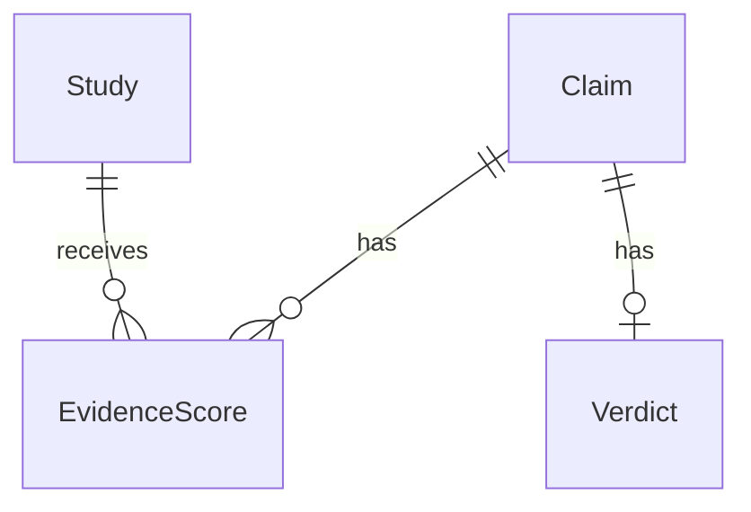

# SecondOpinion
Busting health myths backed by science.

## Project structure

- `frontend/` — React + TypeScript (Vite)
- `backend/` — Python API (FastAPI)

## Getting started

### Backend

Requires Python 3.11+.

```
cd backend
python -m venv .venv
source .venv/bin/activate  # or .venv\Scripts\activate on Windows
pip install -r requirements-dev.txt
uvicorn app.main:app --reload
```

Runs on http://localhost:8000. Health check at `/api/health`. API docs at `/docs`.

Credentials and optional settings go in `backend/.env` (see `backend/.env.example`).

To run the tests:

```
cd backend
source .venv/bin/activate  # or .venv\Scripts\activate on Windows
pytest
```

Backend layout:

```
backend/app/
  main.py       # app factory, middleware, router registration
  config.py     # settings loaded from env / .env
  routers/      # HTTP endpoints (thin, delegate to services)
  models/       # pydantic schemas
  services/     # source API clients, normalization, grading
backend/tests/  # pytest suite
```

Endpoints (full schemas at `/docs`):

| Method | Path | Description |
|---|---|---|
| GET | `/api/health` | Status and API version |
| GET | `/api/pubmed/search?q=...&limit=20` | Search PubMed, returns full study records in relevance order |
| GET | `/api/pubmed/articles/{pmid}` | One PubMed record by PMID, 404 if it does not exist |

PubMed calls are rate limited to stay under NCBI's ceiling (3 requests/second, or 10 with `NCBI_API_KEY` set) and retried on throttling or outages. If PubMed stays down the API returns 503. Tests run against recorded responses in `backend/tests/fixtures/`, so they never hit the live API.

### Frontend

```
cd frontend
npm install
npm run dev
```

Runs on http://localhost:5173 and proxies `/api` requests to the backend.

**Tech:** React 18 + TypeScript, Vite, plain CSS (no framework — see `src/styles/theme.css` for design tokens). Fonts are Comfortaa (body/UI) and Arizonia (the "Second" script wordmark), loaded via Google Fonts in `index.html`.

**Design system:**
- Background is a navy-to-blue diagonal gradient with a radial highlight (`.page` in `theme.css`), matching the Figma prototype
- Three glassmorphism utility classes: `.glass-pill` (translucent, sits on the gradient — eyebrow badge, chips), `.glass-panel` (near-opaque frosted panel, readable dark text — verdict card, chat bubble, status messages), `.glass-card` (translucent dark card — feature cards)

**Pages:**

| Screen | Component | Notes |
|---|---|---|
| Search (home) | `SearchScreen.tsx` | Hero, claim input, example chips, loading/error states, feature cards below the fold |
| Result | `ResultScreen.tsx` | Verdict card (status, confidence score w/ tooltip) + chatbot-style explanation with sources linked inline, compact search bar to check another claim, related-claims chips |
| How it works | `HowItWorksPage.tsx` | Reuses the 3 feature cards; content to be expanded |
| About | `AboutPage.tsx` | Placeholder |

Navigation is React state in `App.tsx`, no router installed yet — logo/wordmark click resets to search, nav links switch pages. No real URLs change per page yet; `react-router-dom` is a quick follow-up if shareable links are needed later.

**Backend integration status:** `POST /api/claims` doesn't exist yet, so `useClaimChecker.ts` mocks one claim ("Is raw milk better for you than pasteurized?") from `src/data/mockResults.tsx` to demo the full flow. Any other claim hits the real fetch, gets a 404 from the missing endpoint, and correctly shows the app's error state — expected, not a bug. Once the real endpoint exists, drop the `MOCK_RESULTS` check in `useClaimChecker.ts` and make sure the response shape matches `VerdictData` in `src/types.ts`.

Frontend layout:

```
frontend/src/
  assets/              logo files
  components/
    NavBar.tsx          nav bar, logo/wordmark, page nav
    SearchScreen.tsx     home/search hero + examples + status states
    ResultScreen.tsx     verdict + chatbot explanation + related claims
    FeatureCards.tsx     claim normalization / evidence grading / retraction checks cards
    HowItWorksPage.tsx
    AboutPage.tsx
  data/
    mockResults.tsx      temporary mock verdict data (see above)
  hooks/
    useClaimChecker.ts   shared state + fetch logic for checking a claim
  styles/
    theme.css            design tokens, gradient, glass utility classes
  types.ts               shared TypeScript types
  App.tsx                page routing (state-based) + top-level layout
```

**Known gaps:** real `/api/claims` endpoint (#22), swap out mock data once it's live, expand How It Works content, About page content, accessibility pass (#28), usability testing (#27).

## Documentation

- [Evidence-grading framework notes](docs/evidence-grading.md)

### Editable backend templates (issue #3)

Start with these two files:

- `backend/app/evidence_models.py`: fields for `Claim`, `Study`, `EvidenceScore`, and `Verdict`. Optional fields explain why they can be unknown.
- `backend/app/evidence_workflow.py`: `create_claim`, `normalize_claim`, `score_study`, and `generate_verdict`.

`create_claim` works in memory. `normalize_claim` returns a search query using
the retrieval-only normalization service described below. Scoring and verdict
functions deliberately raise `NotImplementedError`. Edit one function at a
time; these templates are not connected to API routes or a database.



A study can be reused across claims, but its score belongs to a specific claim.
The proposed schema keeps one current verdict per claim. `None` means unknown
or not assessed; it is different from a score of zero or a checked `False` flag.
IDs are generated in memory; foreign keys, uniqueness, and other database
constraints belong in the later migrations.

Before closing issue #3: agree on the fields and confidence format, post the
relationship diagram to the issue, and collect all four teammates' approvals.
Scoring rules, retrieval, API wiring, and migrations remain separate follow-up work.

### Claim normalization (issue #11)

`app.services.normalization.normalize_claim(raw_text)` returns a `NormalizedClaim`
with `query`, `intervention`, `outcome`, optional `population`, `relation`,
`negated`, and a rules `version`. For example, `does zinc cure colds lol` produces
`"zinc" AND "common cold"`. The workflow wrapper returns just the query string
for compatibility with `Claim.normalized_query`.

The local rules support single English effect claims such as “X causes Y” and
“Does X prevent Y in children?”. They preserve explicit negation in structured
fields while searching the same terms for positive and negative assertions, so
retrieval can find evidence on either side. They never assess truth, score
evidence, or produce verdicts. Call the service directly when downstream code
needs the assertion's relation and negation.

This initial parser uses a finite health-outcome vocabulary. Non-health input,
ambiguous negation, compound claims, comparisons, and unsupported phrasing raise
`ClaimNormalizationError`; rejection does not mean a health claim is false.
Every accepted or rejected call emits an INFO log with `raw_input`,
`normalized_output`, and `error` as structured log-record attributes. Applications
must enable INFO logging and a formatter that includes these attributes to store
them; the module does not configure global logging or persistence.

`backend/tests/test_normalization.py` contains 20 **provisional** seeds plus
negation, rejection, logging, and contract tests. The team's canonical seeds were
not attached to the issue or present in the repository. Tests verify extraction
offline; live study relevance still needs checking against the canonical set
before issue #11 can be closed. The Foundry endpoint is described below.

### Azure Foundry normalization

`POST /api/claims/normalize` uses Azure Foundry (no local-rule fallback). Configure
these in the gitignored `backend/.env`:

```dotenv
AZURE_FOUNDRY_ENDPOINT=https://YOUR-RESOURCE.services.ai.azure.com
AZURE_FOUNDRY_DEPLOYMENT=YOUR-DEPLOYMENT-NAME
AZURE_FOUNDRY_API_KEY=YOUR-RESOURCE-KEY
```

Use a deployment supporting [Chat Completions structured outputs](https://learn.microsoft.com/en-us/azure/foundry/openai/how-to/structured-outputs).
The endpoint can also end with `/openai/v1`; a Foundry project URL is not a model
inference endpoint. Configuration is loaded from `backend/.env` regardless of the
working directory. Restart the API after changing settings.

To send a live claim directly from the backend directory:

```sh
.venv/bin/python -m app.services.foundry_normalization 'does zinc cure colds lol'
```

Or with the backend running:

```sh
curl http://localhost:8000/api/claims/normalize \
  -H 'Content-Type: application/json' \
  -d '{"raw_text":"does zinc cure colds lol"}'
```

The response contains the structured fields above and `version: "foundry-v1"`.
The model extracts fields; code validates them and builds the query without a
verdict. Non-health/ambiguous claims return 422; missing configuration, provider
failures, refusals, and invalid output return 503. Provider error bodies and keys
are not included in responses or application logs. The earlier local-rule service
and workflow wrapper remain available for offline use. Foundry tests mock the
provider; running the CLI with configured credentials is a separate live check.
