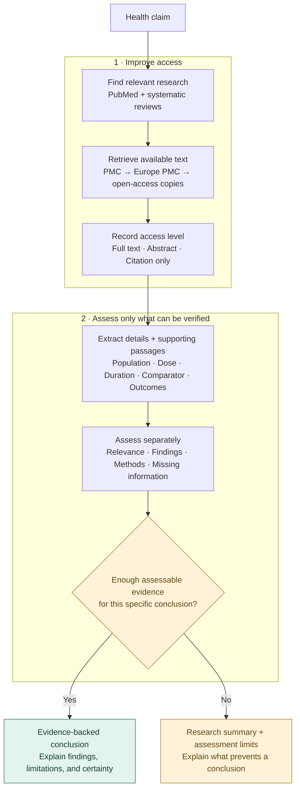
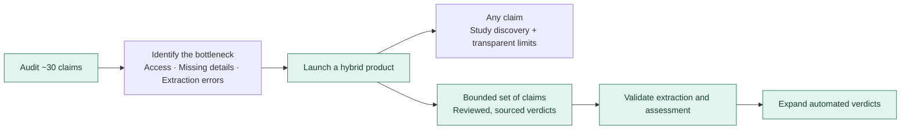

# From research retrieval to defensible verdicts

Brainstorm and proposed direction for SecondOpinion. This describes a recommendation, not implemented behavior.

**Recommendation:** broaden retrieval, make each assessment traceable to source text, and reserve verdicts for claims with enough assessable evidence. Launch with study discovery for arbitrary claims and reviewed verdicts for a bounded set of claims.

## Proposed process

## Recommended rollout

## What each layer solves

| Layer | Proposed solution | Guardrail |
| --- | --- | --- |
| Retrieval | Add Europe PMC and DOI-based open-access discovery through Unpaywall; prefer structured XML/HTML initially. | Verify article identity, version, and permitted access. Measure additional coverage rather than assuming each source adds unique papers. |
| Extraction | Store each value with its supporting passage and location. Mark fields as reported, ambiguous, or unavailable. | Do not infer missing sample sizes, doses, methods, or results from unrelated text. |
| Study assessment | Keep access, relevance, findings, methodological assessment, and missing information separate. | Study design alone does not establish quality. Full-text availability does not establish reliability. |
| Evidence synthesis | Assess comparable outcomes, study limitations, consistency, precision, and applicability before drawing a conclusion. | Do not count a review and its included trials as independent confirmation. |
| Verdict | Return a conclusion only when explicit sufficiency criteria are met; otherwise explain the assessment limit. | Distinguish weak evidence, inconclusive findings, no studies found, and insufficient assessable information. |
| Product scope | Offer broad discovery alongside a bounded set of reviewed verdicts. | Expand automation after validation rather than requiring every search to produce a verdict. |

## Example of a traceable study record

| Field | Example output |
| --- | --- |
| Study design | Randomized trial, based on indexed publication type |
| Access | Abstract only |
| Sample size | Unavailable in retrieved text |
| Dose and duration | Reported values, each linked to a supporting passage |
| Finding | Extracted result for the relevant outcome, linked to a passage; unavailable if no result can be established |
| Methodological assessment | Allocation methods could not be assessed from retrieved text |
| Contribution to conclusion | Depends on relevance, usable findings, and the assessment requirements for that conclusion |

## First experiment

Use a fixed sample of approximately 30 claims. Manually review the retrieved studies and classify failures separately:

1. **Access failure:** needed text could not be retrieved.
2. **Reporting gap:** text was retrieved, but the needed detail was not reported there.
3. **Extraction error:** the detail was present, but the extractor missed or misread it.

Record how many studies each additional retrieval source makes assessable, not just how many documents it returns. Use the results to choose the next investment: retrieval, extraction, or narrower verdict scope. This pilot diagnoses bottlenecks; it does not establish clinical validity.

## Principles to preserve

- Inaccessible does not mean low quality.
- Full text does not mean reliable.
- Missing information must remain visible rather than becoming an invented value or score.
- Insufficient access does not establish that a health claim is false.
- Assessable studies may not represent all relevant evidence; coverage counts alone cannot establish representativeness.
- Verdict sufficiency criteria still need to be defined and validated; this proposal does not supply an automatic scoring formula.

## References

- [Europe PMC API](https://dev.europepmc.org/RestfulWebService): abstracts and eligible open-access full-text retrieval.
- [Unpaywall data format](https://unpaywall.org/data-format): DOI-based open-access locations, versions, and license metadata.
- [Cochrane: Reporting the review](https://www.cochrane.org/authors/handbooks-and-manuals/handbook/current/chapter-iii): reporting findings and certainty of the evidence.
- [Cochrane: Missing evidence](https://www.cochrane.org/authors/handbooks-and-manuals/handbook/current/chapter-13): how missing results can bias a synthesis.
